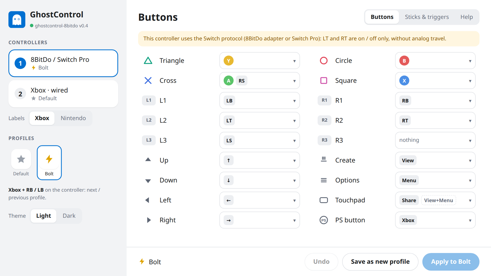
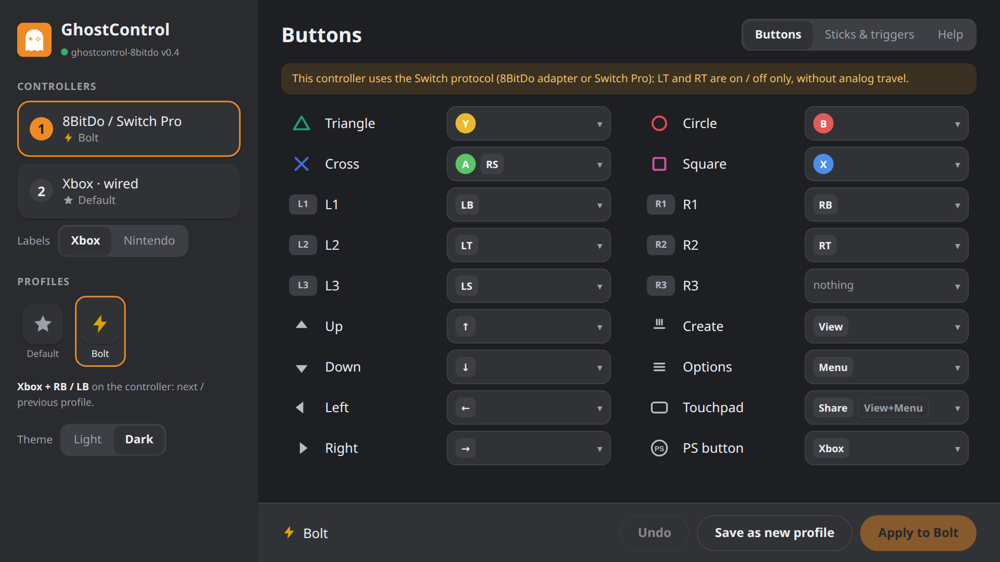

# ghostcontrol-8bitdo

**Xbox controllers on a jailbroken PS5 — through the 8BitDo USB Adapter 2 or by wire — as real DualSense pads.**

[](LICENSE)


A lightweight rework of [GhostControl](https://github.com/StonedModder/Ghostcontrol-PS5-USB-Controller-Patcher) by StonedModder.
It was built mainly for one setup, an **Xbox Elite Series 2 on the 8BitDo USB Adapter 2**, and is meant to be
small, quiet and safe next to the other payloads you run. The console sees a virtual DualSense for each controller:
it works in menus, games and the user picker like a real one. Buttons can be remapped on a page in the console's
own browser, with profiles you switch from the controller.

> **Homebrew.** This is an unofficial, community-made homebrew project. It is **not affiliated with, endorsed by or
> connected to** Sony Interactive Entertainment, Microsoft / Xbox, Nintendo or 8BitDo in any way. See the [disclaimer](#disclaimer).

---

## Contents

- [Features](#features)
- [Supported controllers](#supported-controllers)
- [Button mapping](#button-mapping)
- [Mapper and profiles](#mapper-and-profiles)
- [Installation](#installation)
- [Usage](#usage)
- [What changed compared to GhostControl](#what-changed-compared-to-ghostcontrol)
- [How it works](#how-it-works)
- [Known limitations](#known-limitations)
- [Building](#building)
- [Credits and license](#credits-and-license)
- [Disclaimer](#disclaimer)

## Features

- **8BitDo USB Adapter 2 in Switch mode**: anything the adapter can pair with (Xbox Elite 2, Series X|S, One, …) works.
- **Wired Xbox One / Series pads** over their native USB protocol (GIP).
- **Up to 4 controllers at once**, in any mix.
- **Users are assigned as for a DualSense:**
  - the first controller goes straight to the user at the screen;
  - every further one gets the console's own *"Who is using this controller?"* dialog.
- **Hot-plug**: plug, unplug or swap controllers at any time; rest mode is handled too. Each controller's pad is removed cleanly when it goes away.
- **Button mapper** in the console's browser, opened from a **Media** tile: remap every button, sticks and triggers, light or dark page.
- **Shared profiles** with symbol names (Bolt, Leaf, Drop, …); each controller remembers its own, and **Xbox + RB / LB** switches them in game.
- **No companion app, no system patches**: a single ELF of ~220 KB, the page included.
- **Light on the system**:
  - one thread;
  - a look at the USB ports every 2 s, only while a slot is free;
  - logging only on events, to its own file.
- **Safe by design:**
  - only buses with external ports are scanned;
  - devices are identified read-only;
  - anything that is not a supported controller (USB drives, hubs, keyboards, …) is never claimed.

## Supported controllers

| Connection | Controllers | Status |
|---|---|---|
| **8BitDo USB Adapter 2**, Switch mode | Xbox Elite Series 2 | ✅ tested |
| | Xbox Series X\|S, Xbox One (Bluetooth), Elite 2 Core, Adaptive, Switch Pro, Joy-Con, 8BitDo pads… (whatever the adapter pairs with) | should work: the payload only sees the adapter |
| **USB cable**, Xbox (GIP) | Xbox One (all revisions), One S, Elite, Elite Series 2, Series X\|S, Adaptive | implemented, ⚠️ experimental |
| | Licensed wired pads from PDP, PowerA, Hori | accepted, untested |
| **USB cable**, Switch Pro protocol (`057e:2009`) | Nintendo Switch Pro Controller, 8BitDo pads in Switch mode | should work: same protocol as the adapter |

**Not supported:**
- Xbox 360 / XInput devices, including the 8BitDo adapter in XInput mode.
- The Xbox Wireless Adapter, and Bluetooth straight to the console.
- Generic HID / DirectInput gamepads.
- Wired Xbox pads from other vendors (8BitDo for Xbox, GameSir, Turtle Beach, Razer…): not on the vendor list yet.

> DualSense and DualShock 4 do not need this payload: the console supports them itself.

## Button mapping

The default layout (profile **Default**). Everything except the shortcuts below can be changed in the [mapper](#mapper-and-profiles).

| Xbox | PlayStation |
|---|---|
| A / B / X / Y | Cross / Circle / Square / Triangle |
| LB / RB | L1 / R1 |
| LT / RT | L2 / R2: analog by wire, on/off through the adapter (Switch protocol) |
| L-stick / R-stick click | L3 / R3 |
| View | Create |
| Menu | Options |
| Xbox button | PS |
| **View + Menu** together | Touchpad click |
| Share (Series X\|S, by wire) / Capture (Switch protocol) | Touchpad click |

Stick Y is converted to PlayStation orientation for both protocols, so you don't need an inverted-axis profile in 8BitDo Ultimate Software.

You can also remap with the adapter's own profile in **8BitDo Ultimate Software**; the payload's mapper then works on top of what the adapter sends. Edit the profile for **Switch mode** (each mode has its own), and do not turn on stick Y inversion in it: the payload already converts the axis, so it would end up upside down.

## Mapper and profiles

<p align="center">
  
  
</p>

**Open it** from the **Media** tab: the payload adds a *GhostControl 8BitDo* tile on its first start (and again only if the tile is removed or its icon changes).
From a phone or a computer on the same network: `http://<ps5-ip>:8096/`.

- **Left:** connected controllers, label style, profiles, theme.
- **Rows:** every PlayStation button with its own glyph (the D-pad is four rows). Next to it, the buttons of your controller that press it; several are allowed, e.g. Cross ← A + RS. Click a row to change it: the picker shows what each controller button does now.
- **Not used:** controller buttons mapped to nothing.
- **Sticks & triggers:** swap sticks, invert any axis, dead zone per stick, LT / RT press point, View + Menu touchpad on / off.
- **Help:** every shortcut, the adapter's mode combos included.
- Rows light up while you press the buttons, so you can find them without looking.

**Profiles**

- Shared by all controllers; each controller remembers the one it uses, and different controllers can use different profiles.
- **Default** is built in and cannot be changed.
- **Apply to <profile>** saves your changes into the current profile; **Save as new profile** creates one. Nothing to type: it gets the next free symbol — Bolt, Leaf, Drop, Heart, Moon, Sun, Diamond, Flame, Cloud, Crown, Bell, Clover — and that name is what the console notification shows.
- Click the current profile again to change its symbol or delete it. Controllers that used a deleted profile go back to Default.
- **Xbox + RB / Xbox + LB** on the controller: next / previous profile, with a notification *"Controller 1: Bolt"*. No 8BitDo combo uses the Xbox button, so this cannot change the adapter's mode. A lone Xbox press is still the PS button.
- Buttons are stored **by position** (bottom, right, left, top), not by letter, so a profile works the same on an Xbox pad and on a Switch-layout pad.

**Labels.** Behind the adapter (and for a wired Switch Pro, which reports the same USB id) the payload cannot tell which controller you hold. Pick **Xbox** or **Nintendo** labels for that controller; it only changes the letters on the page.

**Where it is stored** (plain text):
- `/data/ghostpad/profiles/<Name>.ini` — one file per profile;
- `/data/ghostpad/controllers/<id>.ini` — the profile and label style of each controller seen. The id is the USB serial when the controller has a real one, otherwise its port (the adapter has none, so it is remembered per USB port).

## Installation

You need a jailbroken PS5 with a payload loader. Developed and tested on a **PS5 Slim, FW 12.60, kstuff-lite, Payload Manager 0.6.3**.

1. Download `GC_v0.4_8bitdo.elf` from [Releases](../../releases). Keep the file name: Payload Manager reads it and shows the payload as **GC 8bitdo**, version **v0.4**.
2. Load it like any other payload:
   - **Payload Manager:** upload the ELF on its web page (port 8084) and start it from the list;
   - **ELF loader** (port 9021): `nc -q0 <ps5-ip> 9021 < GC_v0.4_8bitdo.elf`.
3. The notification *"ghostcontrol-8bitdo v0.4 started"* appears, and on the first start a *GhostControl 8BitDo* tile appears in **Media**.

The payload keeps running until the console reboots. Add it to your loader's autoload if you want it on every boot.

## Usage

### 8BitDo USB Adapter 2

1. Plug the adapter into the PS5 and pair your controller with it as usual.
2. Put the adapter in **Switch mode: hold View + LB for 3 seconds.**
3. *"controller 1 (8BitDo (Switch mode)) found, press any button"* → press a button → *"controller 1 ready"*.

Your 8BitDo profile (toggled with LB + RB + L3 + R3) works as usual; see [Button mapping](#button-mapping) about stick inversion.

> ⚠️ **View + ↑ / ← / → / ↓** (held 3 s) switch the adapter to other modes (XInput, DInput, Mac, PS Classic), where this payload cannot see it. Switch back with **View + LB**.

### Wired Xbox pad

Plug it into any USB port. You get *"controller N (Xbox controller) found"*, then press a button.

### More players

Each further controller opens the console's *"Who is using this controller?"* dialog after its first button press. Answer it with that controller.

### Stop / update

Launch the payload again: the new copy asks the running one to release the controllers and takes over. You can also
create the file `/data/ghostpad/stop`.

> ⚠️ **Do not kill the process** from a task manager. Killing it in the middle of a USB transfer can crash the console.

The log is in `/data/ghostpad/ghostcontrol-8bitdo.log`; the previous run is in `.log.prev`.

## What changed compared to GhostControl

This project started from GhostControl 1.x (StonedModder). That version was first hardened with a USB guard, then stripped down to what the 8BitDo + Xbox use case needs.

### Fixed

- **Stuck, uncontrollable "Who is using this controller?" dialog.**
  - What happened: `scePadVirtualDeviceAddDevice` reports an error even when it does create the pad, and the pad's id only appears in the kernel log.
  - Two ways it went wrong:
    - if the log was busy, a pad was created blindly, with no input and no way to delete it;
    - old `DEVICE_ADDED` lines (Remote Play, previous runs) could be taken for the new pad.
  - Now: the log is read only for that moment, old lines are drained first, and no pad is created without its id.
- **View acted as the PS button.** The Create button constant was wrong (`0x10000` is PS); it is now `0x1`.
- **Inverted stick Y axis** on the Switch protocol.
- **"Previous PID still exists, reboot PS5"** after a reboot. Payload PIDs repeat on every boot, so the old PID check failed for good. A file lock replaces it.
- **The internal Bluetooth/Wi-Fi chip was probed** (`ugen0.2`, bus 0). Only the external buses are scanned now.
- **Controllers not found again after rest mode**, and pads left behind on disconnect.
- **Kernel panic on stop.** Killing the process mid-transfer could crash the console; stopping now goes through a clean release.

### Added

- Wired Xbox (GIP) support rewritten after the Linux `xpad` driver:
  - the init sequence it sends (power on, One S / Elite 2 init after Bluetooth, LED, auth done);
  - Guide button acknowledgement.
- Several controllers at once, mixed adapter and wired.
- DualSense-style user assignment.
- Xbox Series X|S Share button.
- Controller hot-swap on the adapter.

### Added in 0.4

- The mapper page, shared profiles, Xbox + RB / LB profile switch, Media tile (see [Mapper and profiles](#mapper-and-profiles)).

### Removed (on purpose)

- The XInput (Xbox 360) protocol.
- Threads, debug hooks into ShellUI, test code and verbose logging.

That took the code from ~5000 lines to ~1100 and the ELF from 327 KB to 154 KB (0.3). The mapper in 0.4 adds ~900 lines of C and the page, for ~220 KB in total.

## How it works

```
 8BitDo adapter (057e:2009) ──┐
 wired Xbox pad (GIP) ────────┼─► /dev/ugenX.Y ─► ghostcontrol-8bitdo ─► virtual DualSense ─► PS5
 …up to 4 controllers ────────┘        (USB fs ioctls)     (one thread)     (scePadVirtualDevice*)
```

1. **Scan.** Every 2 s, while a slot is free, `/dev/ugen1.*` and `/dev/ugen2.*` are opened read-only, and the cached device descriptor is checked.
   - Only `057e:2009` or a GIP interface (`ff/47/d0`) is accepted.
   - Storage and hubs are rejected.
2. **Claim.** The console's HID driver is detached from that one interface.
   - HID devices are claimed twice, because the system driver takes the interface back once.
   - Then the protocol handshake runs: Switch `80 02` / `80 04` + subcommands, or the GIP power-on sequence.
3. **Read.** One interrupt-IN transfer stays pending per controller, polled without blocking.
   - Each report becomes a `ScePadData` sent with `scePadVirtualDeviceInsertData`.
   - The last state is repeated every 16 ms, because GIP pads only report changes.
4. **Map.** Each report is normalised to Xbox buttons by position, then the controller's profile turns it into DualSense input (dead zones, inversion, triggers, the View + Menu combo, the Xbox + LB / RB profile switch).
5. **Pad and user.** The virtual pad is created on the first button press, so any dialog it raises has a live controller to answer it.
   - Its id is taken from `/dev/klog`.
   - The first controller is bound to the foreground user with `sceMbusBindDeviceWithUserId`, called inside SceShellUI.
6. **Page.** A small HTTP server on port 8096 is served from the same loop between reports (a slow client can hold it 40 ms at most). The tile in Media is a title with only a `param.json` (deeplink to the page) and an icon, registered with `sceAppInstUtil`.
7. **Release.** On disconnect or stop: cancel the transfer, close the endpoints, give USB back, delete the pad.

| File | Purpose |
|---|---|
| `src/main.c` | slots, scan, USB loop, virtual pads, user assignment, View + Menu combo |
| `src/switch_pad.c` | Switch Pro USB protocol |
| `src/gip_pad.c` | Xbox One / Series USB protocol (GIP), following Linux `xpad` |
| `src/usb_guard.c` | read-only, fail-closed device identification |
| `src/shellui_bind.c` | binds a virtual pad to a user |
| `src/mapper.c` | profiles: mapping, sticks, triggers, combos, text format |
| `src/web.c`, `assets/index.html` | the mapping page and its HTTP API |
| `src/shortcut.c`, `assets/icon0.png` | the Media tile |
| `src/usb_io.h`, `src/gc_types.h` | USB write helper, pad structures |

## Known limitations

- No rumble and no player LEDs.
- No Elite 2 back paddles.
- Through the adapter the triggers are on/off: a limit of the Switch protocol.
- Input rate:
  - the adapter reports every **8 ms** (Switch Pro emulation plus the Bluetooth hop); software cannot speed this up;
  - wired Xbox pads report every **4 ms**, the same as a DualSense over USB.
- One thread: connecting a new controller briefly (≤ ~1 s) freezes the other controllers' input.
- The adapter has no usable serial, so its profile is remembered per USB port: plugged into another port, it starts on Default.
- Wired Xbox support and multiple controllers have not been tested on hardware yet. Reports are welcome.

## Building

Requires the [PS5 Payload SDK](https://github.com/ps5-payload-dev/sdk).

```bash
export PS5_PAYLOAD_SDK=/path/to/ps5-payload-sdk
make                        # → ghostcontrol-8bitdo.elf
make send PS5_HOST=<ip>     # optional: send to an ELF loader on port 9021
```

## Credits and license

- [StonedModder](https://github.com/StonedModder) for [GhostControl](https://github.com/StonedModder/Ghostcontrol-PS5-USB-Controller-Patcher), the base of this project.
- The Linux kernel [`xpad`](https://github.com/torvalds/linux/blob/master/drivers/input/joystick/xpad.c) driver, the reference for the Xbox GIP protocol.
- The [ps5-payload-dev](https://github.com/ps5-payload-dev) SDK.

Licensed under **GPL-3.0-or-later**, like the original GhostControl. See [LICENSE](LICENSE).

## Disclaimer

- This is **homebrew software** for jailbroken consoles, made by enthusiasts.
- It is **not affiliated with, authorized, endorsed or supported by** Sony Interactive Entertainment, Microsoft Corporation / Xbox, Nintendo or 8BitDo (Shenzhen 8BitDo Tech Co., Ltd.), nor by any of their partners.
- PlayStation, PS5 and DualSense are trademarks of Sony Interactive Entertainment Inc. Xbox and Xbox Elite are trademarks of Microsoft Corporation. Nintendo Switch is a trademark of Nintendo. 8BitDo is a trademark of 8BitDo. All other trademarks belong to their respective owners and are used here only to describe compatibility.
- No proprietary code, firmware or keys from these companies are included.
- The software is provided **"as is", without warranty of any kind** (see [LICENSE](LICENSE)). Running homebrew on a console is at your own risk.
